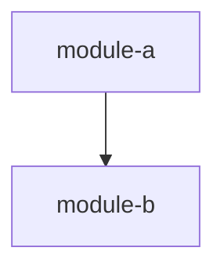

# Code Schematic

Spec version 1.0 (changes: [Changelog](#changelog))

A code schematic explains software in pseudocode, the way an electrical schematic explains a circuit. It is simpler than the real thing, it uses a standard notation, and every symbol in it stands for a real part. This spec defines how to write one. Use it to explain an existing codebase, to propose a design, or to hand work to a coding agent (Claude, Copilot, Codex, and others).

It works for any mainstream language: Java, Kotlin, Python, TypeScript, Go, C#, Rust, and similar. The notation borrows from all of them but belongs to none.

## Contents

- [Why a standard](#why-a-standard)
- [Who reads what](#who-reads-what)
- [Quick look](#quick-look)
- [Document set](#document-set)
- [The system overview](#the-system-overview)
- [The module schematic](#the-module-schematic)
- [The flow schematic](#the-flow-schematic)
- [Linking to real code](#linking-to-real-code)
- [Notation](#notation)
- [Writing rules](#writing-rules)
- [Mapping to real languages](#mapping-to-real-languages)
- [Rendering](#rendering)
- [Instructions for AI agents](#instructions-for-ai-agents)
- [Review checklist](#review-checklist)
- [Templates](#templates)
- [Full example](#full-example)
- [Prior art](#prior-art)
- [Changelog](#changelog)

## Why a standard

Pseudocode is easy to write and easy to get wrong. Without shared rules, every author picks their own level of detail, their own symbols, and their own idea of what to leave out. Readers then have to learn each author's style before they can learn the system.

This standard fixes three things:

1. **Layout.** Every schematic has the same sections in the same order, so readers know where to look.
2. **Notation.** A small set of symbols with one meaning each.
3. **What must be written down.** Types, behavior, rules, and examples. These are the parts that people and agents most often guess wrong when they are missing.

## Who reads what

A schematic has several audiences. Each section is written so a reader can stop once they have what they need.

| Reader | Reads | Wants to know |
|---|---|---|
| Engineering manager | Overview, module summaries, examples | What exists, how parts connect, what "done" means |
| Developer new to the code | Everything, in order | How it works and why |
| Developer changing the code | Contracts, behavior, rules | What they must not break |
| Coding agent | Everything | Exactly what to build or how existing code behaves |

## Quick look

Here is a small module schematic, so you can see the shape before the details.

````markdown
# Module: rate-limiter

> Lets each client make at most N requests per time window. Rejects the rest.

@module   rate-limiter
@files    src/ratelimit/RateLimiter.kt
@depends  clock
@used-by  http/middleware

## Contracts

```
interface Clock
    now() -> Instant

class RateLimiter(limit: Int, window: Duration, clock: Clock)
    tryAcquire(clientId: String) -> Bool
```

## Behavior

@src src/ratelimit/RateLimiter.kt#tryAcquire

```
fn tryAcquire(clientId) -> Bool
    bucket = buckets[clientId] or new Bucket(start = clock.now(), count = 0)
    if clock.now() - bucket.start >= window:
        bucket = new Bucket(start = clock.now(), count = 0)    // window expired, reset
    if bucket.count >= limit:
        return false
    bucket.count += 1
    buckets[clientId] = bucket
    return true
```

## Rules

```
MUST     count each client separately
MUST     be safe to call from many threads at once
MUST NOT read the system clock directly    // why: tests need a fake clock
```

## Examples

```
GIVEN limit = 2, window = 1s
WHEN  client "a" calls tryAcquire 3 times within 1s
THEN  results are true, true, false
```
````

## Document set

In this spec, a *schematic* is one of the Markdown documents written with it: the system overview, a module schematic, or a flow schematic. The schematics for a whole system live in one folder:

```
schematic/
  README.md            the system overview (one per system)
  <package-a>/         one folder per top-level package
    <module-1>.md      one module schematic per module
    <module-2>.md
  <package-b>/
    <module-3>.md
  flows/               optional: schematics for flows that cross many modules
    <flow-name>.md
```

The schematic folder mirrors the code's top-level packages, and only that level. A package maps to a folder one to one. Below that, a single module schematic may cover many source files, so the schematic tree is a simpler copy of the code tree. For a small system with one package, put module schematics directly in `schematic/`.

**What counts as a module** is up to you. Pick the unit a developer would work on as one piece: a package, a service, a directory, or a few closely related files. A good module schematic is 100 to 500 lines, not counting the Source map. If it gets much longer, split the module.

**Flow schematics** are for behavior that does not live in any one module, such as "a request from login to first page load". See [The flow schematic](#the-flow-schematic).

## The system overview

The overview is the entry point. A manager should be able to read only this file and understand the system.

It has these sections:

1. **Title and summary.** One paragraph: what the system does and for whom.
2. **Snapshot header.** `@repo` (where the code lives) and `@commit` (the version the schematics describe). See [Linking to real code](#linking-to-real-code).
3. **Module map.** A table of modules, one line each, with a link to each module schematic.
4. **Code map.** A pruned folder tree showing where each module lives. See [The code map](#the-code-map).
5. **Dependency diagram.** Which modules call which. Use a Mermaid diagram or an indented list. Arrows point from caller to callee.
6. **Key flows.** Two to five of the most important things the system does, each as a numbered list of steps that names the modules involved.
7. **Glossary.** Terms that have a specific meaning in this system.
8. **Reading order.** Which module schematics to read first.

The code map and the dependency diagram answer different questions. The code map says where things are. The diagram says who calls whom. Folders rarely match the call graph, so keep both.

### The code map

The code map is the real folder tree, cut down to what a reader needs. It is not a full listing.

```
services/
  api/                          HTTP API (Python)                 → api/routes.md
    app/main.py                   entry: create_app()
    app/routes/                   one file per resource (9 files)
  jobs/                         background jobs (Kotlin)
    src/jobs/JobQueue.kt          entry: submit(), start()         → jobs/job-queue.md
    src/jobs/handlers/            one file per job kind (6 files)  → jobs/handlers.md
  billing/                      payments (Go)
    internal/charge/              card charges (4 files)          → billing/charge.md
    ...                           reports: out of scope
  admin-ui/, load-tests/        out of scope
```

Pruning rules:

- Show at most 3 levels of nesting below the root. A level is one step of indentation, not one folder: you MAY join folders into one path, like `src/core/tools/`, and it counts as one level. Join folders when the ones in between hold nothing worth showing. This keeps deep monorepos readable.
- Show a file only if it is an entry point or the main file of a module. Collapse the rest of the folder to a count, like `(12 files)`.
- Use `...` for anything hidden that is not worth a count.
- End each shown line with a short description. Point to the schematic with `→ path.md`, or say why it is out of scope.
- Put two or more out-of-scope siblings on one line.

## The module schematic

Every module schematic has these sections, in this order. Sections marked optional can be left out when they would be empty.

### 1. Title and summary

```
# Module: <name>

> One or two sentences on what this module does and why it exists.
```

Then a short paragraph of plain prose if the module needs more context. Write it for someone who has never seen the code.

### 2. Header

```
@module   <name>
@files    <paths to the main source files>
@depends  <modules this one calls>
@used-by  <modules that call this one>
```

`@files` ties the schematic to real code. For a design that is not built yet, write the paths where the code should go.

### 3. Contracts

The types and public functions other modules can see. Write only the public surface here. Private helpers go in Behavior.

Include, for each type:

- its fields, with types
- which fields are optional
- a short `//` comment on any field whose name does not explain itself

If the contracts are long, split them into several blocks grouped by topic (for example "Messages", "Events", "Config"), each with a one-line intro. Each block SHOULD stay under about 40 lines.

### 4. Behavior

How the module works, as pseudocode. This is the main section.

- Start with the most important function (usually the entry point), then the functions it calls, top down.
- Write one function per code block, or a few short related ones together.
- Put a sentence or two of prose before each block saying what it does and when it runs.
- Put an `@src` line above each block, pointing to the real code. See [Linking to real code](#linking-to-real-code).

### 5. Rules

Things that must always be true, written as one-line statements with a strength keyword. See [Rule keywords](#rule-keywords).

Rules are where you write down ordering, thread safety, error handling, limits, and anything else that is easy to break by accident.

### 6. Examples

Concrete cases in Given / When / Then form. Each example should be specific enough to become a test. Cover at least the normal case and the most important edge case.

When the schematic describes existing code, say where each example comes from on the line above it:

| Tag | Meaning |
|---|---|
| `@test path#"test name"` | Taken from this test. The strongest source. |
| `@test-e2e path#"test name"` | Taken from a test that needs a real external service or credentials (an LLM, a payment gateway), so it is skipped in normal runs. |
| `@derived` | Worked out by reading the code. No single test covers it. |
| `@combined` | Joins behavior that separate tests check one piece at a time. |

Examples that need a real external service are fine. Describe what the code does with the response. If a test covers it, use `@test-e2e` so readers know the test exists but may not run in CI. If no test covers it, use `@derived`.

### 7. Notes (optional)

Design decisions, known limits, and history that explain why the code looks the way it does.

### 8. Open questions (optional)

Things that are not decided yet. Readers and agents MUST NOT resolve these on their own.

### 9. Source map

A table that lists how the schematic's functions map to the real code, and what the schematic left out. It comes last because most readers will not need it. Reviewers and agents use it to check coverage. See [The source map](#rule-4-the-source-map).

## The flow schematic

A flow schematic follows one piece of work as it passes through several modules. It uses the module schematic sections, with these changes:

| Module schematic | Flow schematic |
|---|---|
| `# Module: <name>` | `# Flow: <name>` |
| `@module`, `@depends`, `@used-by` | `@flow <name>` and `@modules <every module involved, in order of first appearance>` |
| `@files` | Leave out. Each step's `@src` gives the file. |
| Contracts | **Participants**: a table of modules and their role in this flow. Link to their schematics instead of repeating their types. |
| Behavior | **Steps**: the flow in time order. Prefix every call with its module (`api.createOrder()`), so the reader always knows where the step runs. |
| Rules, Examples, Notes, Open questions, Source map | Same as in a module schematic |

A sequence diagram (Mermaid `sequenceDiagram`) SHOULD come before the Steps when more than three modules are involved.

## Linking to real code

A reader must be able to go from any line of the schematic to the code it describes. Pseudocode is much shorter than the code, so the links also have to show how it was shortened. Four rules do this, one for each level of zoom.

| Zoom level | Artifact | How it links to code |
|---|---|---|
| System | Snapshot header and code map | `@repo`, `@commit`, folder paths |
| Module | Module header | `@files` |
| Function | Behavior block | `@src file#symbol` |
| Line | Names inside pseudocode | Code-style names are real, prose is a summary |

### Rule 1: Code-style names are real, prose is a summary

Inside pseudocode, a name written like code (`runLoop`, `claimNext()`, `JobStatus`, `config.maxAttempts`) MUST be a real symbol. A reader can search the code for it and find it.

The rule covers names that a reader would search for: types, functions, methods, fields, events, constants, and config keys. It does not cover local variables and parameters. Those you MAY rename for readability (`job` for `claimedJob`, `delay` for `backoffDelaySeconds`), though you SHOULD keep the code's name when it is already clear.

A line in plain English (`try the job again later`) is a summary written by the schematic author. It may stand for one line of code or fifty.

This rule is what lets a schematic simplify safely. Authors can collapse as much as they like using prose, and readers always know which parts are the real thing.

Sometimes a long real function has no helpers to point to, and one of its steps deserves its own Behavior block. Then you MAY invent a name for that step, but you MUST mark it on the `@src` line as `(inline)`:

```
### scheduleRetry
@src src/jobs/Worker.kt#Worker.runOne (inline)
```

This says: "`scheduleRetry` is not a real function. It is a named piece of `Worker.runOne`." Use an invented name only in its own block and in the line that calls it. Call it on a line of its own, so a renderer can unfold it there (see [Folding invented functions](#folding-invented-functions)).

An invented name is worth it when:

- the step does one job you can name with a verb, like "schedule a retry";
- it takes few inputs and gives back few outputs (if it needs most of the parent's local variables, leave it in place and label it with a comment instead);
- it does not hold the control flow the reader needs to see. A `return` or `break` that leaves the parent stays in the parent.

If you own the code and the step really is its own unit, consider extracting a real function in the code instead. The doc then points to a real name.

Block headings follow the same rule. A heading written as a code name (`### runLoop`) must be real or marked `(inline)`. A heading written in plain words (`### Email handler`) is prose and needs no mark.

Some real code has no name of its own: an anonymous function, a lambda, or a method on an object literal returned by a factory. Point `@src` at the nearest named symbol, add the path to the unnamed part, and mark it `(anonymous)`:

```
### Email handler
@src src/jobs/handlers/Email.kt#emailHandler.run (anonymous)
```

This says: "the code is the `run` method of the object that `emailHandler` returns."

### Rule 2: An `@src` anchor on every Behavior block

Put an `@src` line between the block's heading and its prose. Point to the file and the symbol, not to line numbers. Line numbers change with every edit, while symbol names rarely do.

```
@src path/to/file.ts#functionName
@src path/to/File.kt#ClassName.methodName
@src path/to/file.py#function_name, #other_function       // block merges two functions
@src path/to/File.kt#Worker.runOne (inline)               // invented name, see Rule 1
@src path/to/File.kt#emailHandler.run (anonymous)         // unnamed code, see Rule 1
```

Paths are relative to `@repo`. When several symbols are in the same file, write the path once and start the rest with `#`.

Inside a block, when a prose step stands for a real helper that the schematic does not expand, point at it with an arrow comment:

```
check the payload against the handler's schema    // → validatePayload
```

### Rule 3: Pin the snapshot

The system overview starts with:

```
@repo     <URL or local path of the repository>
@commit   <commit hash or tag the schematics describe>
```

Code changes all the time, so a schematic always describes one version. When you update the schematic for newer code, update `@commit` too.

### Rule 4: The source map

The last section of each module schematic is a table. It lists the real functions the schematic covers and how the schematic treated each one.

```markdown
| Schematic | Real code | How |
|---|---|---|
| `runLoop` | `Worker.runLoop` | same |
| `runOne` | `Worker.runOne`, `Worker.persist` | merged |
| `scheduleRetry` | part of `Worker.runOne` | inline |
| (not shown) | `JobQueue.stop`, `Worker.logFailure` | omitted: shutdown flag and logging |
```

The "How" column uses these words:

| Word | Meaning |
|---|---|
| `same` | One schematic function for one real function |
| `merged` | Several real functions shown as one |
| `inline` | Invented name for part of a real function (Rule 1) |
| `split` | One real function shown as several schematic blocks |
| `omitted: <reason>` | Left out on purpose |

Group small helpers into one "omitted" row. The goal is to make the shortening visible, not to list every line.

### Naming across modules

Inside pseudocode, prefix a call to another module with that module's schematic name: `storage.save(...)`, `billing.Charge`, `jobQueue.submit(...)`. Calls inside the same module have no prefix. A reader can then see when a call crosses a module boundary without looking anything up.

Use the module name, not the import path. `storage.save()` reads better than `com.example.shop.storage.JobStore.save()`. The code map tells the reader where `storage` lives.

The prefix names the schematic where the reader will find the pseudocode, which is not always the file where the code lives. Two cases come up often:

- **One schematic describes methods that live in another module's files.** For example, a `retry-policy` schematic may describe backoff methods that sit inside the `Worker` class. Callers write `retryPolicy.nextRunAfter()`, because that is where the pseudocode is. The `@src` line gives the real location. The describing schematic MUST list those files in its `@files` and say in its summary which methods it covers.
- **The code has no schematic (it is out of scope).** Use the real class or module name from the code, in its original casing: `SmtpClient.send()`. Module prefixes are always lowerCamelCase, so a capitalized prefix tells the reader "this is a real class with no schematic". List it as out of scope in the overview's module map.

## Notation

### Code blocks

Write pseudocode in fenced code blocks with no language tag. Indentation shows nesting (4 spaces). There are no braces and no semicolons.

### Types

| Notation | Meaning |
|---|---|
| `Int`, `Float`, `Bool`, `String`, `Bytes` | Basic types |
| `Instant`, `Duration` | A point in time, a length of time |
| `List<T>`, `Map<K, V>`, `Set<T>` | Collections |
| `T?` | Optional or nullable `T` |
| `A \| B` | Either an `A` or a `B` (union, sealed class, tagged enum) |
| `"a" \| "b"` | One of these exact string values |
| `Any` | Unknown type. Avoid it where you can. |
| `T[]` | Same as `List<T>`. Use whichever reads better. |

Defining types:

```
type Point = { x: Float, y: Float }

type Shape =                       // a union of record types
    Circle { center: Point, radius: Float }
  | Square { corner: Point, side: Float }

interface Store
    get(key: String) -> Bytes?
    put(key: String, value: Bytes)

class Cache(store: Store, maxSize: Int)        // constructor arguments in parentheses
    get(key: String) -> Bytes?
```

### Functions

| Notation | Meaning |
|---|---|
| `fn name(a, b) -> T` | A function returning `T`. Leave off `-> T` if it returns nothing. |
| `async fn name()` | A function that waits on I/O (Promise, Future, suspend, coroutine) |
| `await x` | Wait for an async result. You may leave out `await` when it is obvious. |
| `x.f?()` | Call `f` only if it exists. Result is empty if it does not. |
| `a or b` | `a` if present and not empty, otherwise `b` |
| `return x` | Return a value |
| `throw Error("msg")` | Raise an error |

Argument types can be left out of `fn` lines in Behavior when they already appear in Contracts.

### Control flow

```
if cond:
    ...
else if other:
    ...
else:
    ...

for each item in items:
    ...

while cond:
    ...

loop:                          // runs until break or return
    ...
    break

match value:                   // switch / when / match
    Circle c:   ...
    Square s:   ...
    otherwise:  ...

try:
    ...
catch NotFound e:
    ...
finally:
    ...
```

### Concurrency and events

| Notation | Meaning |
|---|---|
| `run in parallel: a, b, c` | Start all, wait for all |
| `spawn task()` | Start in the background, do not wait |
| `lock name: ...` | Only one caller at a time inside this block |
| `emit event_name{fields}` | Publish an event to listeners |
| `on event_name(e): ...` | Handle an event |

### Calls across modules

| Notation | Meaning |
|---|---|
| `Module.fn()` | Call into another module. Use the real module and function name. |
| `CALL Module.fn()` | Same, but emphasised. Use it when the cross-module hop matters to the reader. |
| `@hook name` | A point where outside code (plugins, callbacks, config) can change behavior |

### Comments

| Notation | Meaning |
|---|---|
| `// text` | Plain comment |
| `// why: text` | The reason for a choice. Readers and agents MUST keep the behavior this explains. |
| `// note: text` | Something surprising the reader should know |
| `// todo: text` | Not done yet (for design schematics) |
| `...` | Detail left out on purpose. The implementer decides. |

### Prose shortcuts

Plain English inside pseudocode is allowed and encouraged when it is clearer than code:

```
remove expired entries from cache
sort users by last login, newest first
retry up to 3 times with exponential backoff
```

Use a shortcut only when any competent developer would implement it the same way. If there is a choice that matters, write the choice down.

### Rule keywords

Rules use the keywords from RFC 2119:

| Keyword | Meaning |
|---|---|
| `MUST` | Required. Breaking it is a bug. |
| `MUST NOT` | Forbidden. Doing it is a bug. |
| `SHOULD` | Expected, unless there is a good reason. Write the reason down if you deviate. |
| `SHOULD NOT` | Avoid, unless there is a good reason. |
| `MAY` | Allowed, not required. |

Write one rule per line, starting with the keyword. Add a `// why:` comment when the reason is not obvious.

```
MUST     return results in the same order as the input
MUST NOT hold the lock while calling the network    // why: one slow call would block everyone
SHOULD   log a warning when the queue is over 80% full
```

### Examples

```
GIVEN <starting state>
  AND <more state>
WHEN  <action>
THEN  <expected result>
  AND <more results>
```

Use real values ("limit = 2", "user 'alice'"), not placeholders.

## Writing rules

These keep schematics readable and keep them true.

1. **Name things as the code does.** If the code says `tryAcquire`, the schematic says `tryAcquire`, not `acquirePermit`. Readers should be able to search the codebase for any code-style name in the schematic. When you need a name the code does not have, follow [Rule 1](#rule-1-code-style-names-are-real-prose-is-a-summary) and mark it `(inline)`.
2. **Write the what and the why, skip the how-to-type-it.** Leave out logging, null checks, imports, getters, and boilerplate unless they change behavior.
3. **Keep one level of detail per block.** Do not mix "process the order" with "increment i by 1" in the same function. If a step needs detail, give it its own block below, pointing to the real helper or using an `(inline)` name.
4. **Keep every branch that changes behavior.** Simplifying is fine. Dropping an edge case is not. If the code handles it, the schematic mentions it (in Behavior or Rules).
5. **Explain surprising code with `// why:`.** If a careful reader would ask "why is it done this way?", answer it.
6. **Prefer short blocks.** Aim for under 30 lines per Behavior block and under 40 lines per Contracts block.
7. **Use prose for context, pseudocode for logic.** Each section opens with a sentence or two of plain English.
8. **Do not invent.** When describing existing code, write only what the code does. If you are unsure, say so in Open questions.
9. **Keep it current.** A wrong schematic is worse than none. Update the schematic in the same change that updates the behavior.

## Mapping to real languages

The notation is meant to translate directly. This table shows the usual mapping.

| Schematic | TypeScript | Java | Kotlin | Python | Go |
|---|---|---|---|---|---|
| `T?` | `T \| undefined` | `@Nullable T` / `Optional<T>` | `T?` | `T \| None` | `*T` |
| `A \| B` | union type | sealed interface | sealed class | `Union[A, B]` | interface |
| `type X = {...}` | `type` / `interface` | record | data class | `@dataclass` | struct |
| `interface` | `interface` | `interface` | `interface` | `Protocol` / ABC | interface |
| `async fn` | `async function` | `CompletableFuture` | `suspend fun` | `async def` | goroutine + channel |
| `List<T>` | `T[]` | `List<T>` | `List<T>` | `list[T]` | `[]T` |
| `Map<K,V>` | `Map<K,V>` | `Map<K,V>` | `Map<K,V>` | `dict[K, V]` | `map[K]V` |
| `throw` | `throw` | `throw` | `throw` | `raise` | return `error` |
| `match` | `switch` | `switch` | `when` | `match` | `switch` |
| `emit` | event emitter / callback | listener | Flow / callback | callback | channel send |

When a schematic is about one codebase, it is fine to use that language's own idioms where they read more clearly. Just keep them consistent within the schematic.

## Rendering

Schematics are Markdown, and they MUST read well as plain text. A renderer (a static site, an editor plugin, a review tool) MAY add links and color on top. This section says what a renderer should link and which kinds of words to tell apart. It does not require exact colors.

### Links

A renderer SHOULD turn these into links:

| In the doc | Links to |
|---|---|
| `@src path#symbol` | The symbol's line in the repository at `@commit` |
| `@test path#"name"` | The line where that test is declared |
| `@files` paths | The files at `@commit` |
| `// → helperName` | The helper's line, looked up in the block's `@src` files |
| `→ path.md` in the code map | The page for that doc |
| Links between `.md` files | The matching pages |
| A call inside pseudocode, like `scheduleRetry()` or `storage.save()` | The Behavior block that describes it, found through each block's heading and `@src` symbols |
| A type name inside pseudocode | The line in Contracts that defines it |
| A function or type name in inline code in prose | The same targets as above |
| A call to an invented `(inline)` function | The same as any call, and it also folds (see below) |

When a name has more than one match, the renderer SHOULD pick in this order: the module named by the call's prefix, then the same module doc, then the only module doc that has it, then the same flow doc. If it is still ambiguous, leave the name unlinked rather than guess.

Line numbers are safe here, unlike in `@src` itself. The renderer works them out at build time against the pinned `@commit`, which never changes. Rebuild after updating `@commit`.

### Folding invented functions

An invented `(inline)` function is a named part of a real function. A renderer SHOULD let the reader open it where it is called:

- Closed, the line shows the call, like `scheduleRetry(job, e)`. The parent reads as a short list of steps.
- Open, the pseudocode of the invented block appears under the call, without its `fn` line. It MUST NOT look like a nested block of the parent, so the renderer SHOULD:
  - put it in a framed box that starts at the call's column, with no extra indent;
  - give the box a header and a footer in body text, not code, saying which real function the lines belong to and that control goes back to the call;
  - mark each `return` inside the box as a return to the call line, not out of the parent.
- The control that opens a fold SHOULD look like an editor's fold box (`+` and `−`) in the left margin, and the call line SHOULD have a light tint so it stands out while closed.
- Folds start closed. A block with folds SHOULD offer "open all".
- The invented block keeps its own section too, so links to it and its notes still work.
- Only invented functions fold. A real function has its own place in the code, so its call links to its section instead.

This shows both views at once: the short version an author chose, and the fuller version that matches the shape of the real code. The Markdown needs no extra syntax. The `(inline)` mark on the `@src` line is enough.

### Highlight classes

A renderer SHOULD tell these classes apart inside pseudocode blocks:

| Class | What it covers | Example |
|---|---|---|
| keyword | Words that give the code its shape | `fn`, `async`, `if`, `for each`, `return`, `throw`, `match`, `emit`, `spawn` |
| symbol | Code-style names: calls, camelCase or snake_case names, fields after a dot | `claimNext()`, `runAfter`, `job_failed` |
| type | Capitalized names | `JobStatus`, `Handler` |
| module | The prefix of a cross-module call | `storage` in `storage.save()` |
| literal | Strings and numbers | `"failed"`, `3` |
| comment | Plain comments | `// window expired` |
| why | `// why:` comments | `// why: tests need a fake clock` |
| reference | `// →` comments | `// → validatePayload` |
| rule | MUST, MUST NOT, SHOULD, SHOULD NOT, MAY at the start of a rule | `MUST NOT` |
| example | GIVEN, WHEN, THEN, AND at the start of an example line | `GIVEN` |
| invented | A name marked `(inline)`: not in the code, so not something to search for | `scheduleRetry()` |
| plain | Everything else: prose summaries, local variables, operators | `try the job again later` |

Renderer rules:

- Keep the **plain** class in the normal text color. Then a reader learns one fact: colored names are real and can be found in the code, and plain words are a summary. This is [Rule 1](#rule-1-code-style-names-are-real-prose-is-a-summary) made visible.
- Give rules three strengths: MUST and MUST NOT get the strongest color, SHOULD gets a softer warning color, and MAY stays neutral.
- Make **why** comments stand out more than plain comments, because they are constraints.
- Make **invented** names look different from real ones, for example italic, with a tooltip that names the real function they belong to. Otherwise readers search the code for them and find nothing.
- MUST NOT carry meaning in color alone. The syntax already marks every class, so the page has to read correctly in black and white too.
- SHOULD work in both light and dark themes, and SHOULD show a short legend.

The highlighter can work with simple text rules. It needs no parser and no knowledge of the original language.

### Suggested palette

Teams MAY use their own colors. Using this default keeps docs from different teams looking alike.

| Class | Light theme | Dark theme | Style |
|---|---|---|---|
| keyword | `#7a3eb1` | `#c49cf0` | bold |
| symbol | `#1f5fbf` | `#7fb2ff` | |
| type | `#0b7a75` | `#5fd1c8` | |
| module | `#b4530b` | `#f2a35e` | |
| literal | `#2f7a2f` | `#8fd18f` | |
| comment | `#6b7280` | `#9aa3b2` | |
| why | `#8a5a00` | `#e6b450` | bold label |
| reference | same as symbol | same as symbol | underlined when linked |
| rule MUST / MUST NOT | `#c0262d` | `#ff7b7b` | bold |
| rule SHOULD / SHOULD NOT | `#a15c00` | `#f0b35a` | bold |
| rule MAY | `#4b5563` | `#b6bdc8` | bold |
| example | same as keyword | same as keyword | bold |
| invented | same as symbol | same as symbol | italic, dashed underline |
| plain | page text color | page text color | |

## Instructions for AI agents

This section is for coding agents. Humans can skip it.

### When writing a schematic from existing code

1. Read this whole standard first.
2. Read the source files in full. Do not write from search snippets.
3. Start with the system overview. List modules before describing any of them.
4. For each module, find the public surface first (Contracts), then trace the main entry point (Behavior).
5. Use the exact names from the code for modules, types, functions, fields, and events.
6. Every branch in the code that changes visible behavior MUST appear in Behavior or Rules.
7. Every non-obvious choice SHOULD get a `// why:` comment. Take the reason from code comments, commit messages, docs, or test names. If the only source is a test, say so: `// why: (test: "does not retry a cancelled job") ...`. If you cannot find a reason, do not make one up.
8. Examples MUST describe behavior the code really has. Prefer cases taken from existing tests, and tag each one with `@test`, `@test-e2e`, `@derived`, or `@combined`.
9. Put anything you are unsure about in Open questions instead of guessing.
10. Link everything to the code: `@repo` and `@commit` in the overview, `@files` in each module header, `@src` on every Behavior block, and a Source map at the end of each module schematic. Get the commit with `git rev-parse --short HEAD`.
11. Build the code map from the real folder tree (for example `ls` or `tree -L 3`), then prune it using the code map rules.

### When writing code from a schematic

1. Read the system overview, then the module schematic, then the schematics of every module listed in `@depends`.
2. Implement Contracts exactly as written: names, fields, and signatures.
3. Follow Behavior for logic. `...` and prose shortcuts are yours to fill in.
4. Treat every `MUST` and `MUST NOT` as a hard requirement, and every `// why:` as a constraint.
5. Turn every Example into a test.
6. Do not decide Open questions. Stop and ask.
7. Put files where `@files` and `@src` say.
8. A name marked `(inline)` does not exist in the code. Do not call it from real code. When you write code from the schematic, either write that step inside its parent or create the function on purpose.

## Review checklist

Use this when reviewing a schematic, whether a person or an agent wrote it.

- [ ] Can a manager understand the system from the overview alone?
- [ ] Does every module schematic have a one-sentence summary that makes sense to a newcomer?
- [ ] Does the overview have `@repo`, `@commit`, and a pruned code map?
- [ ] Does every code-style name exist in the code, with invented names marked `(inline)` and unnamed code marked `(anonymous)`?
- [ ] Does every Behavior block have an `@src` line?
- [ ] Does each module schematic end with a Source map that shows what was merged or left out?
- [ ] Are all public types and functions in Contracts?
- [ ] Is each Behavior block at one level of detail and under about 30 lines?
- [ ] Are error cases, ordering, and concurrency covered in Behavior or Rules?
- [ ] Does each surprising choice have a `// why:`?
- [ ] Is every Example concrete enough to become a test, and tagged with its source?
- [ ] Is anything stated that the code does not actually do?
- [ ] Are unknowns listed in Open questions instead of guessed?

## Templates

### System overview template

````markdown
# <System name>

> <One paragraph: what the system does and who uses it.>

@repo     <URL or path>
@commit   <hash or tag>

## Modules

| Module | Summary | Schematic |
|---|---|---|
| <name> | <one line> | [<package>/<name>.md](<package>/<name>.md) |

## Code map

```
<root>/
  <package>/                 <one line>
    <path/to/entry-file>       <one line>              → <package>/<name>.md
    <folder>/                  <one line> (N files)
  <other>/, <other>/         out of scope
```

## How the modules connect



## Key flows

### <Flow name>

1. <Step, naming the module involved>
2. <Step>

## Glossary

| Term | Meaning |
|---|---|
| <term> | <meaning in this system> |

## Reading order

1. <module> because <reason>
````

### Module schematic template

````markdown
# Module: <name>

> <One or two sentences: what it does and why it exists.>

<Optional short paragraph of context.>

@module   <name>
@files    <paths>
@depends  <modules>
@used-by  <modules>

## Contracts

<One sentence introducing the types.>

```
type ...
interface ...
```

## Behavior

### <function name>
@src <path>#<symbol>

<One or two sentences: what it does and when it runs.>

```
fn ...
```

## Rules

```
MUST ...
MUST NOT ...
```

## Examples

@test <path>#"<test name>"
```
GIVEN ...
WHEN  ...
THEN  ...
```

## Notes

<Design decisions and history. Optional.>

## Open questions

<Undecided items. Optional.>

## Source map

| Schematic | Real code | How |
|---|---|---|
| `<fn>` | `<symbol>` | same |
````

## Full example

A complete module schematic for a small job queue written in Kotlin. It shows every section in use, including an invented `(inline)` function.

````markdown
# Module: job-queue

> Runs background jobs with a fixed number of workers, and retries jobs that fail.

Other modules submit jobs and get back an id. They can check a job's status
later. Jobs that throw are retried a few times with a growing delay before
being marked as failed.

@module   job-queue
@files    src/jobs/JobQueue.kt, src/jobs/Worker.kt
@depends  storage, clock
@used-by  api/routes, reports/scheduler

## Contracts

```
type JobId = String

type JobStatus = "queued" | "running" | "done" | "failed"

type Job = {
    id: JobId,
    kind: String,              // which handler runs it, e.g. "send_email"
    payload: Map<String, Any>,
    status: JobStatus,
    attempts: Int,
    lastError: String?,
    runAfter: Instant,         // not picked up before this time
}

interface Handler
    async run(payload: Map<String, Any>)

class JobQueue(storage: Storage, clock: Clock, workers: Int = 4, maxAttempts: Int = 3)
    register(kind: String, handler: Handler)
    submit(kind: String, payload) -> JobId
    status(id: JobId) -> JobStatus?
    async start()
    async stop()
```

## Behavior

### submit
@src src/jobs/JobQueue.kt#JobQueue.submit

Saves a new job and returns at once. The job runs later on a worker.

```
fn submit(kind, payload) -> JobId
    if kind not in handlers:
        throw Error("unknown job kind: " + kind)
    job = Job(id = new uuid, kind, payload, status = "queued",
              attempts = 0, runAfter = clock.now())
    storage.save(job)
    return job.id
```

### start
@src src/jobs/JobQueue.kt#JobQueue.start

Starts the worker loops. Each worker takes one job at a time.

```
async fn start()
    for i in 1..workers:
        spawn Worker(this).runLoop()
```

### runLoop
@src src/jobs/Worker.kt#Worker.runLoop

Each worker repeats this until `stop()` is called.

```
async fn runLoop()
    while not stopping:
        job = storage.claimNext(now = clock.now())   // atomically sets status = "running"
        if job is empty:
            sleep 1s
            continue
        await runOne(job)
```

### runOne
@src src/jobs/Worker.kt#Worker.runOne, #Worker.persist

Runs one job and records the outcome.

```
async fn runOne(job)
    job.attempts += 1
    try:
        await handlers[job.kind].run(job.payload)
        job.status = "done"
    catch e:
        scheduleRetry(job, e)
    storage.save(job)
```

### scheduleRetry
@src src/jobs/Worker.kt#Worker.runOne (inline)

The `catch` branch of `runOne`. A failed job waits longer after each attempt, until it runs out of attempts.

```
fn scheduleRetry(job, e)
    job.lastError = e.message
    if job.attempts >= maxAttempts:
        job.status = "failed"
    else:
        job.status = "queued"
        job.runAfter = clock.now() + 2^job.attempts seconds    // 2s, 4s, ...
```

## Rules

```
MUST     never run the same job on two workers at once    // why: handlers are not idempotent
MUST     save the job after every attempt, success or failure
MUST NOT let a handler exception stop the worker loop
SHOULD   finish running jobs before stop() returns
MAY      run jobs out of submit order
```

## Examples

@test src/jobs/JobQueueTest.kt#"job succeeds on first attempt"
```
GIVEN a handler for "send_email" that always succeeds
WHEN  submit("send_email", {to: "a@x.com"}) is called and a worker runs
THEN  status(id) is "done" and attempts is 1
```

@test src/jobs/JobQueueTest.kt#"job fails after max attempts"
```
GIVEN maxAttempts = 3 and a handler that always throws "smtp down"
WHEN  the job runs until it stops
THEN  it runs 3 times, waiting 2s then 4s between runs
  AND status is "failed" and lastError is "smtp down"
```

@derived
```
GIVEN no handler registered for "resize"
WHEN  submit("resize", {}) is called
THEN  it throws "unknown job kind: resize" and nothing is saved
```

## Notes

Backoff is in-process only. If the service restarts, `runAfter` in storage
still holds, so retries resume at the right time.

## Open questions

- Should failed jobs be deleted after some time, or kept forever?

## Source map

| Schematic | Real code | How |
|---|---|---|
| `submit`, `start` | `JobQueue.submit`, `JobQueue.start` | same |
| `runLoop` | `Worker.runLoop` | same |
| `runOne` | `Worker.runOne`, `Worker.persist` | merged |
| `scheduleRetry` | `catch` branch of `Worker.runOne` | inline |
| (not shown) | `JobQueue.stop`, `Worker.logFailure` | omitted: shutdown flag and logging |
````

## Prior art

This standard combines ideas that already work well on their own:

- **RFC 2119**: the MUST / SHOULD / MAY keywords.
- **Design by contract** (Eiffel, JML, Dafny): stating what must always be true.
- **Given / When / Then** (Gherkin, BDD): examples that become tests.
- **C4 model**: describing a system from the top down, one zoom level at a time.
- **Program Design Language** (Caine and Gordon, 1975; also in *Code Complete*): pseudocode as a design tool written before code.
- **Spec-driven development** (GitHub Spec Kit, Kiro): giving coding agents a written spec instead of a long chat.

## Changelog

### 1.0

- First public release.
